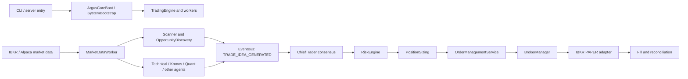
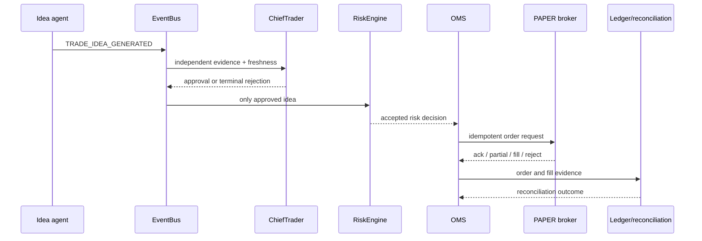

# Argus architecture and defect audit (Oct. 2026 snapshot)

**Status: partial source audit.** This map follows the documented runtime boundaries and the Oct. 12–16 forensic evidence. It is not a claim that every first-party file or dependency has been line-by-line reviewed. The living architecture remains [`ARGUS_ARCHITECTURE.md`](../architecture/ARGUS_ARCHITECTURE.md); this dated report records verified audit findings and gaps.

## Trading and startup paths

Startup has a parent process/CLI boundary, bootstrap and runtime worker lifecycle, then broker activation/reconciliation and trading-state checks. `scripts/sim/marketOpen.ts` and `scripts/sim/fullSession.ts` are parent launchers; children set isolation variables at process spawn before importing DB/EventBus/broker code. Synthetic orders route to `HistoricalReplayBroker`; this does not make synthetic fills organic PAPER evidence.

## Ownership map

| Concern | Principal boundary | Audit note |
|---|---|---|
| Runtime lifecycle and CLI | `scripts/argus-cli.ts`, server boot modules, `src/server/core/` | CLI readiness and process health are separate from market-data and entry-generation readiness |
| Market data and subscription lifecycle | `src/server/marketData/`, broker adapters, scanner modules | A subscription request/ack does not prove a fresh usable quote or complete strategy inputs |
| Discovery and scheduling | `src/server/continuous/`, discovery and scheduling services | Control-plane priority changes must not turn into signal or risk authority |
| Quant calculation | `src/server/quant/`, `quant-core-java/` | Java authority applies to new quant calculations; current Java advisory/live-vote wiring remains separately gated |
| Decision and provenance | `src/server/services/ChiefTraderAgent.ts`, `EvidenceAggregator.ts`, `src/server/core/EventBus.ts` | Protected consensus stays at 0.75 and two independent groups; historical terminal payloads were too sparse for full per-vote replay |
| Risk and execution | RiskEngine, PositionSizing, OMS, BrokerManager, reconciliation | Protected path; no bypasses or thresholds changed in this work |
| Persistence | `src/server/db/`, `src/server/observability/` | Slow synchronous DB and persistence events were measured Oct. 16 but not causally joined to individual missed votes |
| Simulation and certification | `src/server/replay/synthetic/`, `scripts/sim/`, `src/server/certification/` | Existing suite exercises real decision/Risk/OMS boundaries with isolated clock, DB and replay broker in selected scenarios; coverage is not the same as full production traffic fidelity |

## Shared dependencies and known coupling

The EventBus is a synchronous coordination point; better-sqlite3 persistence and some history reads can share the Node event loop with evaluation/monitoring. Market data, quant assessment, Java HTTP calls, AI provider calls, periodic maintenance and telemetry therefore require independent latency and queue evidence before asserting they interfere. Oct. 16 supplied slow SQL/persistence counts, but not a causal join to a terminal consensus deadline. Previous Oct. 12–13 investigations found long Quant evaluation paths and heavy on-demand overlap; subsequent source changes added timing and in-flight controls, but do not establish current runtime deployment.

## Defect audit status

| Finding | Classification | Evidence/status |
|---|---|---|
| Disk guard used a shell-interpolated reason; `<` could be interpreted as redirection | Reproduced production defect | `scripts/ops/diskFloorGuard.test.ts` has incident-shaped old-behavior reproduction and argv-safe fix coverage; focused test passed |
| Simulator artifact floor (15 GiB) disagreed with 26 GiB disk guard/operational floor | Reproduced policy mismatch | Fixed on this `main` worktree; config parity tests added and passed |
| `marketOpen.ts` lacked disk preflight before creating isolated simulation DB | Verified missing protection | Added preflight against the exact temp DB volume; no large run executed |
| Oct. 16 rate-limit and consensus event lineage was insufficient for retrospective causal analysis | Verified observability limitation | Oct. 16 old records cannot be repaired; prospective instrumentation is in a separate worktree and not included here |
| Slow SQL/persistence calls correlate to missed votes | Unproven | No decision/deadline join; do not classify as cause |
| Discovery filters missed named Oct. 16 winners | Unproven | Eight of ten names have no queried event evidence; required contemporaneous eligibility inputs absent |

## Order lifecycle

The architecture diagram is intentionally concise; module details and live invariants remain governed by the living architecture and `AGENTS.md`.
