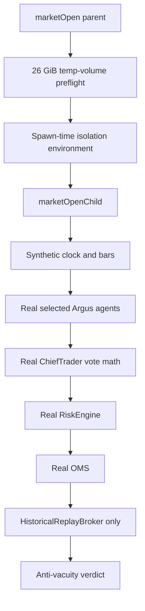

# Argus market-open simulator design and current capability

## Existing design

The supported market-open entry is `npm run sim:market-open -- ...`; `npm run test:certification` invokes its Test A (quiet abstention) and Test B (synthetic seeded-calibration capability control). The launcher computes isolated paths and starts a child with `SYNTHETIC_SIMULATION=true`, `PAPER_TRADING_ONLY=true`, `ARGUS_DB_PATH` set before imports, real market-data WebSockets disabled, and the synthetic broker selected. The child uses synthetic bars/clock and the real selected Argus decision, risk and OMS components; broker execution stays inside `HistoricalReplayBroker`.

## Implemented correction

`marketOpen.ts` now loads the repository artifact policy and checks free space on the exact volume containing its temporary simulation DB before spawning a child. `config/syntheticArtifacts.json` uses 26 GiB, matching the formula in the new `config/diskSafety.json` (15 GiB recovery + 8 GiB observed transient-loss reserve + 3 GiB next-session DB growth). The old environment override that could lower the synthetic floor was removed. These changes are covered by focused tests; no full session was run.

## Limits and proposed suite tiers

The current `--certify` workflow runs two deterministic capability/safety scenarios. It is not yet a market-data historical replay or production-open workload simulator. It does not establish a full-day fidelity envelope, source-specific event bursts, real provider behavior, or production database latency. The command `argus certify premarket` is not currently implemented; `argus certify-next-session` is the existing CLI readiness route and can invoke simulation only with its documented option.

| Tier | Intended scope | Current state |
|---|---|---|
| QUICK_PREMARKET | build/config, critical focused regressions, no-trade invariant, short isolated startup and known-failure probes | Not yet a single supported tiered command |
| FULL_PREMARKET | full existing certification suite, isolated DB, provider/broker fault matrix, report manifest | Components exist; end-to-end unified manifest incomplete |
| MARKET_OPEN_STRESS | source-shaped opening bursts, queue/latency measurement, 1x/2x measured load | Not certified; no safe run performed in this audit |
| PRODUCTION_FAILURE_REPLAY | deterministic recorded defects, adversarial timing, causal assertions | Existing replay tests cover selected cases; catalog is incomplete |
| FULL_SYSTEM_CERTIFICATION | all categories with per-category PASS/FAIL/BLOCKED/NOT_RUN | Not implemented as one truthful aggregate gate |

Real historical replay must use event availability timestamps and keep completed-bar information unavailable until interval close. Synthetic faults may be injected into a replay but must be labelled separately. Any performance thresholds must be based on measurements, not invented promises.
